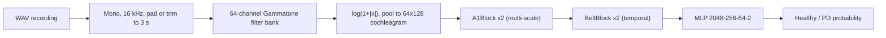

<div align="center">

# 🎙️ AuditoryNet

### Speech-based Parkinson's Disease Detection using Deep Learning

*Gammatone cochleagrams + an auditory-cortex-inspired CNN*


[](https://colab.research.google.com/drive/1tGTlA_Rhn3L0WG0blJNVVmunUnih3L1B?usp=sharing)
[](https://colab.research.google.com/drive/1Ze-_IXOMGnTxv5HYxIbk_JYpedSjYwSy?usp=sharing)

**Department of Electronics Engineering · SVNIT Surat · Project Phase-I (2025–26)**

</div>

> [!WARNING]
> **Research prototype - not a medical device.** The output is a similarity score to the Parkinson's samples the model was trained on. It is **not** a diagnosis. Consult a clinician for any health concern.

---

## 📑 Contents

[Why this project](#-why-this-project) · [How it works](#-how-it-works) · [Quick start](#-quick-start) · [Dataset](#-dataset) · [The GUI](#-the-gui) · [Model](#-model-architecture) · [Training & evaluation](#-training--evaluation) · [Results](#-results) · [Structure](#-project-structure) · [CLI](#-command-line-reference) · [Deploy](#-deploy-online) · [Troubleshooting](#-troubleshooting) · [Limitations](#-limitations--ethics) · [Future work](#-future-work) · [Team](#-team)

---

## 💡 Why this project

Parkinson's disease (PD) often changes the voice years before motor symptoms appear: reduced loudness, flat pitch, breathiness and imprecise articulation. A microphone is a cheap, non-invasive screening tool compared with DaTscan or MRI.

Most deep-learning systems feed **mel-spectrograms** into generic CNNs. AuditoryNet instead mimics the ear and the auditory brain:

| Idea | Implementation |
|---|---|
| 👂 Cochlea-like front end | 64-channel **Gammatone** filter bank, ERB-spaced 80–8000 Hz → **cochleagram** |
| 🧠 Primary auditory cortex (A1) | **A1Block**: parallel 3×3 / 5×5 / 7×7 convolutions + skip connection |
| 🧠 Auditory belt | **BeltBlock**: depthwise-separable convolution that integrates longer time spans |
| ⚖️ Small, imbalanced data | weighted sampling, class-weighted loss, augmentation, early stopping |
| 🧪 Honest evaluation | nested model selection + optional **speaker-disjoint** folds |

---

## 🔬 How it works



---

## 🚀 Quick start

Pick **one** route.

<details open>
<summary><b>☁️ A · Google Colab with a free GPU (fastest, recommended)</b></summary>

1. Put `auditorynet_project.zip` (this repo zipped) and `dataset.zip` in your Google Drive.
2. Click the **GUI** Colab badge at the top (or upload `notebooks/AuditoryNet_Colab_GUI.ipynb`).
3. `Runtime → Change runtime type → T4 GPU`.
4. Run cells **1 → 5**. The app opens inline and via a link.
5. Use the tabs: **Dataset → Train → Results → Predict**.

Results and trained models are saved to your Drive, so a disconnect does not lose finished tasks.
Set `GUI_PASSWORD` in cell 2 before sharing the link.

</details>

<details>
<summary><b>💻 B · Local GUI (Windows / Linux / macOS)</b></summary>

```powershell
git clone https://github.com/shams-altaf143/Speech-Based-Parkinson-s-Disease-Detection.git
cd Speech-Based-Parkinson-s-Disease-Detection

python -m venv .venv
.\.venv\Scripts\Activate.ps1          # Linux/macOS: source .venv/bin/activate
pip install -e ".[dev]"               # for GPU, install the CUDA build of PyTorch first (pytorch.org)
pytest -q                             # optional sanity check

auditorynet-gui                       # opens the Streamlit app in your browser
```

On Windows you can also double-click **`run_gui.bat`** after the first setup.

</details>

<details>
<summary><b>⌨️ C · Command line only</b></summary>

```powershell
auditorynet-train --config configs\default.yaml                 # all tasks
auditorynet-train --tasks E petaka --epochs 25 --device cuda    # selected tasks
auditorynet-predict recording.wav --task E                      # score one recording
```

</details>

> 💡 CPU training of all tasks can take hours. Use Colab, or start with `--tasks E --epochs 5`.

---

## 📂 Dataset

Six speech tasks, each with Parkinson's (`PD`) and healthy-control (`Healthy`) recordings:

| Task | What the speaker does | What it reveals |
|---|---|---|
| **A, E, I, O, U** | sustain a vowel | tremor, breathiness, glottal irregularity |
| **petaka** | repeat the syllables /pe-ta-ka/ quickly | articulatory coordination |
| **apto** | say a short sentence | prosody and connected speech |

**Folder layout** (folder names are not case-sensitive; WAV files may be nested):

```text
data/
├── A/      PD/*.wav   Healthy/*.wav
├── E/      PD/*.wav   Healthy/*.wav
├── I/ O/ U/ petaka/ apto/          (same structure)
```

- Recordings are resampled to **16 kHz mono** and padded/trimmed to **3 s**.
- Tasks with a missing folder, or fewer than 10 files per class, are skipped with a warning.
- **Speaker IDs:** if one speaker has several recordings, put the ID in the file name (for example `spk012_E.wav`) and set `speaker_regex` so the same speaker never appears in both training and test.

<!-- EDIT THIS BLOCK to match how you share the data. Delete the options you do not use. -->
**Getting the data**
- Stored in `data/` with **Git LFS**. Install it *before* cloning: `git lfs install`. If you cloned without it, run `git lfs pull`.
- Or: download `dataset.zip` from the repository's **Releases** page and extract it into `data/`.

> [!NOTE]
> The recordings are health-related voice data. Use them only within the permissions and consent they were collected under, and do not redistribute them without approval.

---

## 🖥️ The GUI

| Tab | What you can do |
|---|---|
| **1 · Dataset** | Scan your folders and see PD / Healthy file counts per task, with a ready / not-ready status |
| **2 · Train** | Choose tasks and settings, press **Start**, watch live progress and the log, **Stop** any time |
| **3 · Results** | Summary table, per-task dashboards, learning curves, and **overfitting warnings** |
| **4 · Predict** | Upload or record a voice sample → PD-likelihood score, per-window chart and cochleagram |

Two interfaces share the same engine:

| Interface | Command | Best for |
|---|---|---|
| Streamlit | `auditorynet-gui` | local use |
| Gradio | `from auditorynet.gradio_gui import App` | Colab and online demos |

---

## 🧠 Model architecture

Input: cochleagram `1 × 64 × 128` → output: logits for **[Healthy, PD]**.

| Stage | Details | Output shape |
|---|---|---|
| A1Block 1 + MaxPool + GroupNorm | parallel 3×3, 5×5, 7×7 conv (32 channels split 11/11/10) + 1×1 skip | 32 × 32 × 64 |
| A1Block 2 + MaxPool + GroupNorm | same, 64 channels (22/21/21) | 64 × 16 × 32 |
| BeltBlock × 2 | depthwise conv (5 along time × 3 along frequency) + pointwise + BN + GELU + residual | 64 × 16 × 32 |
| Adaptive average pool | to 4 × 8 | 2048 |
| Classifier | Linear 2048→256 → GELU → Dropout(0.4) → Linear 256→64 → GELU → Dropout(0.2) → Linear 64→2 | 2 |

The exact parameter count is printed when training starts.

---

## ⚙️ Training & evaluation

<details>
<summary><b>Default hyper-parameters</b> (all editable in <code>configs/default.yaml</code> or the GUI)</summary>

| Parameter | Value |
|---|---|
| Sampling rate / clip length | 16 kHz / 3.0 s |
| Gammatone channels / frames | 64 / 128 |
| Optimiser | AdamW, lr 1e-3, weight decay 1e-4 |
| Scheduler | CosineAnnealingLR (T_max = epochs) |
| Epochs / batch size | 25 / 16 |
| Loss | cross-entropy, inverse-frequency class weights, label smoothing 0.05 |
| Class balance | weighted random sampler + class-weighted loss |
| Augmentation | time mask (1–10 frames), frequency mask (1–8 channels), noise, time shift |
| Regularisation | dropout 0.4 / 0.2, gradient clipping 1.0, early stopping (patience 8) |
| Seed | 42 |

</details>

**Evaluation protocol**

1. **5-fold stratified cross-validation** per task (speaker-disjoint if `speaker_regex` is set).
2. Inside each training fold, an **inner validation split** picks the best epoch (highest AUC-ROC) and drives early stopping.
3. The outer **test fold is used once**, so scores are not inflated by model selection.
4. Reported: accuracy, AUC-ROC, sensitivity, specificity, precision / recall / F1, confusion matrices, and the **train-test accuracy gap**.

> [!TIP]
> **Overfitting?** The app warns when the train-test gap exceeds 10 points. Check `outputs/<task>_history.png`, then raise dropout / label smoothing / weight decay, lower epochs, or use a speaker regex.

---

## 📊 Results

Numbers reported in the Phase-I report (5-fold CV, 600 clips per task: 300 PD + 300 HC):

| Task | Mean accuracy | Mean AUC-ROC |
|---|---|---|
| A | 94.7 % | 0.9968 |
| E | 93.7 % | 0.9920 |
| I | 95.7 % | 0.9880 |
| O | 95.3 % | 0.9910 |
| U | 89.0 % | 0.9700 |
| petaka | 86.0 % | 0.9100 |
| apto | 82.0 % | 0.8800 |

> [!IMPORTANT]
> Those figures chose the best epoch on the same fold they report, and folds were split by clip. This repository uses a **stricter protocol** (held-out test folds, optional speaker-disjoint splits), so **expect lower numbers** on a re-run. Your own results appear in `outputs/summary.csv` and the **Results** tab.

Generated outputs: `summary.csv` · `<task>_5fold_results.png` · `<task>_history.png` · `all_datasets_comparison.png` · `checkpoints/<task>_fold<k>.pt`

---

## 🗂️ Project structure

```text
.
├── configs/default.yaml          # all settings
├── notebooks/                    # Google Colab notebooks (training, GUI)
├── src/auditorynet/
│   ├── gammatone.py              # filter bank + cochleagram
│   ├── model.py                  # A1Block, BeltBlock, AuditoryNet
│   ├── dataset.py  discovery.py  # file discovery, features, Dataset
│   ├── augment.py                # SpecAugment + noise + shift
│   ├── train.py                  # CV training, early stopping, CLI
│   ├── metrics.py  plots.py      # evaluation and figures
│   ├── predict.py                # fold-ensemble inference
│   ├── gui_app.py                # Streamlit GUI
│   ├── gradio_gui.py             # Gradio GUI
│   └── gui_utils.py  gui.py      # GUI helpers and launcher
├── tests/                        # pytest suite (synthetic audio)
├── Dockerfile  run_gui.bat
└── pyproject.toml  requirements.txt
```

---

## ⌨️ Command-line reference

| Command | Purpose |
|---|---|
| `auditorynet-train [--config F] [--data-dir D] [--output-dir D] [--tasks T ...] [--epochs N] [--device cpu\|cuda]` | train and evaluate |
| `auditorynet-predict WAV... --task T [--ckpt-dir D] [--threshold X]` | score recordings with the 5-model ensemble |
| `auditorynet-gui` | start the Streamlit app |
| `pytest -q` | run the tests |

Long recordings are split into 3-second windows; all fold models are averaged.

---

## 🌐 Deploy online

A predict-only app (no training buttons) can be hosted free on **Hugging Face Spaces**: create a Gradio Space, add the `src/` folder, an `app.py`, `requirements.txt` and your `outputs/checkpoints/*.pt` files. Keep it **private** until approved, keep the disclaimer visible, and do not store uploaded voices.

---

## 🛠️ Troubleshooting

<details>
<summary><b>PowerShell: <code>&&</code> is not a valid statement separator</b></summary>

Windows PowerShell 5 does not support `&&`. Run the commands one per line.

</details>

<details>
<summary><b>Activating the virtual environment is blocked</b></summary>

```powershell
Set-ExecutionPolicy -Scope CurrentUser RemoteSigned
```

</details>

<details>
<summary><b><code>auditorynet-train</code> is not recognised</b></summary>

The environment is not active. Activate it, or run `python -m auditorynet.train ...`.

</details>

<details>
<summary><b>Colab: <code>No module named 'auditorynet.gradio_gui'</code></b></summary>

Run the "GUI code" cell (the one starting with `%%writefile`) before launching, and do not unzip the project into a folder named `auditorynet`; that name shadows the Python package.

</details>

<details>
<summary><b>Large train-test gap / overfitting warning</b></summary>

See the tip under [Training & evaluation](#-training--evaluation).

</details>

<details>
<summary><b>GPU out of memory</b></summary>

Lower `batch_size` in the config or the Train tab.

</details>

---

## ⚠️ Limitations & ethics

- Small datasets (about 600 clips per task) → limited generalisation across speakers, microphones, rooms and languages.
- Not clinically validated; do not use for diagnosis or treatment decisions.
- Clip-level scores can be optimistic if one speaker appears in several folds, so use `speaker_regex`.
- Tasks such as *petaka* are language-specific.
- Voice recordings are sensitive personal data: keep them private, obtain consent, and follow applicable data-protection rules.

---

## 🔭 Future work

Cross-task transfer learning · speaker-level aggregation across vowels · visibility-graph features · Transformer temporal modelling · learnable Gammatone front end · INT8 quantisation for mobile / edge · longitudinal severity tracking (UPDRS) · multi-language evaluation.

---

## 👥 Team

| | |
|---|---|
| **Students** | Jadhav Sahil Amol (U23EC022) · Mohammad Altaf (U23EC093) · Patil Aman Mahesh (U23EC122) |
| **Guide** | Dr. Suman Deb, Assistant Professor, DoECE |
| **Institute** | Sardar Vallabhbhai National Institute of Technology, Surat |
| **Head of Department** | Dr. (Ms.) Shilpi Gupta |

**Cite this work**

```text
J. S. Amol, M. Altaf, P. A. Mahesh, "Speech-based Parkinson's disease detection using deep learning,"
Project Phase-I Report, Dept. of Electronics Engineering, SVNIT Surat, 2025-26.
```

**Key references:** Patterson et al., *An efficient auditory filterbank based on the gammatone function* (1992) · Park et al., *SpecAugment* (2019) · Little et al., *Suitability of dysphonia measurements for telemonitoring of Parkinson's disease* (2009).

<div align="center">

⭐ If this helped you, star the repository.

</div>
